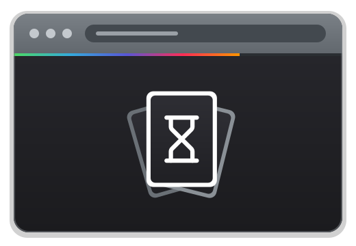

<h1 align="center">docker-steam-game-idler</h1>

<p align="center">
  <a href="https://github.com/wielorzeczownik/docker-steam-game-idler/actions/workflows/release.yml"><picture><source media="(prefers-color-scheme: dark)" srcset="https://img.shields.io/github/actions/workflow/status/wielorzeczownik/docker-steam-game-idler/release.yml?branch=main&style=flat-square&labelColor=2d333b&color=3fb950"/><source media="(prefers-color-scheme: light)" srcset="https://img.shields.io/github/actions/workflow/status/wielorzeczownik/docker-steam-game-idler/release.yml?branch=main&style=flat-square&color=2ea043"/></picture></a> <a href="https://github.com/wielorzeczownik/docker-steam-game-idler/releases/latest"><picture><source media="(prefers-color-scheme: dark)" srcset="https://img.shields.io/github/v/release/wielorzeczownik/docker-steam-game-idler?style=flat-square&labelColor=2d333b&color=3fb950"/><source media="(prefers-color-scheme: light)" srcset="https://img.shields.io/github/v/release/wielorzeczownik/docker-steam-game-idler?style=flat-square&color=2ea043"/></picture></a> <a href="https://hub.docker.com/r/wielorzeczownik/steam-game-idler"><picture><source media="(prefers-color-scheme: dark)" srcset="https://img.shields.io/docker/pulls/wielorzeczownik/steam-game-idler?style=flat-square&labelColor=2d333b&color=3fb950"/><source media="(prefers-color-scheme: light)" srcset="https://img.shields.io/docker/pulls/wielorzeczownik/steam-game-idler?style=flat-square&color=2ea043"/></picture></a> <a href="https://github.com/wielorzeczownik/docker-steam-game-idler/blob/main/LICENSE"><picture><source media="(prefers-color-scheme: dark)" srcset="https://img.shields.io/badge/License-MIT-3fb950?style=flat-square&labelColor=2d333b"/><source media="(prefers-color-scheme: light)" srcset="https://img.shields.io/badge/License-MIT-2ea043?style=flat-square"/></picture></a>
  <br/>
  
  <a href="https://hub.docker.com/r/wielorzeczownik/steam-game-idler"></a>
</p>

<p align="center">
  
</p>

[Steam Game Idler](https://github.com/zevnda/steam-game-idler) packed into a Docker image, with its window served to your browser. It runs on a server or NAS around the clock, so you don't need a desktop that stays on.

The image unpacks the official Linux release of the app, unchanged, on top of [jlesage/baseimage-gui](https://github.com/jlesage/docker-baseimage-gui), which provides the web viewer.

> [!NOTE]
> This is an unofficial image. It isn't affiliated with or endorsed by zevnda, the author of Steam Game Idler, or by Valve. Steam is a trademark of Valve Corporation.

## Running

### Docker

```bash
docker run -d --name steam-game-idler --restart unless-stopped \
  --platform linux/amd64 \
  -p 5800:5800 \
  -v "$PWD/config:/config" \
  wielorzeczownik/steam-game-idler:latest
```

Then open `http://<host>:5800` and sign in to Steam as you would on a desktop.

For Docker Compose, grab [docker-compose.example.yml](docker-compose.example.yml), save it as `docker-compose.yml` and run `docker compose up -d`.

Steam Game Idler ships for x86_64 only. ARM hosts, such as a Raspberry Pi or an Apple Silicon Mac, run the image through emulation, which works but is slower.

### Tags

| Tag           | Meaning                                                |
| ------------- | ------------------------------------------------------ |
| `latest`      | newest stable image                                    |
| `<version>`   | a specific image release, e.g. `1.2.0`                 |
| `sgi-<x.y.z>` | newest image with that version of Steam Game Idler     |
| `next`        | release candidate built from `main`, may be unfinished |

## Configuration

Everything the app saves (the Steam session, settings, logs) lives in `/config`. Keep it on a volume, otherwise you'll sign in again after every update.

The web viewer comes from the base image, so all of its [environment variables](https://github.com/jlesage/docker-baseimage-gui#environment-variables) work. The ones you're most likely to want:

| Variable                      | Default   | Meaning                                              |
| ----------------------------- | --------- | ---------------------------------------------------- |
| `TZ`                          | `Etc/UTC` | time zone, see the [list][tz]                        |
| `USER_ID` / `GROUP_ID`        | `1000`    | owner of the files in `/config`                      |
| `WEB_AUTHENTICATION`          | `0`       | `1` asks for a login before showing the app          |
| `WEB_AUTHENTICATION_USERNAME` | -         | login for the web viewer                             |
| `WEB_AUTHENTICATION_PASSWORD` | -         | password for the web viewer                          |
| `DARK_MODE`                   | `0`       | `1` gives the window frame a dark theme              |
| `DISPLAY_WIDTH` / `_HEIGHT`   | `1920`    | size of the virtual screen (height defaults to 1080) |

[tz]: https://en.wikipedia.org/wiki/List_of_tz_database_time_zones

> [!WARNING]
> Whoever reaches port 5800 controls your Steam account. Don't expose it to the internet. Keep it on your LAN or behind a VPN, and turn on `WEB_AUTHENTICATION` if others share the network.

### PRO license

Steam Game Idler ties a PRO license key to the machine ID. Each container gets its own ID on first start and keeps it in `/config/machine-id`, so it survives updates. Delete that file and the app sees a new device.

## License

The files in this repository (Dockerfile, scripts, workflows) are under the [MIT License](LICENSE).

Steam Game Idler itself is under the [Elastic License 2.0](https://github.com/zevnda/steam-game-idler/blob/main/LICENSE), and the image ships it unchanged. Its license and third-party notices come with it, in `/usr/lib/Steam Game Idler/` inside the image. In short, it lets you run the image for yourself, but not offer Steam Game Idler to other people as a hosted service, and not work around its license key (PRO) checks. Read the full text before you build anything on top of it.
